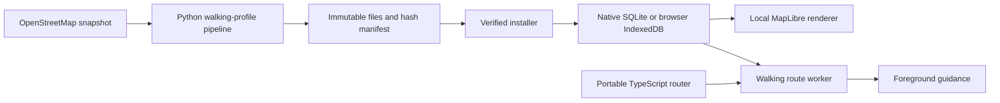

# OFFGRID

**Offline walking navigation for Android, with a web companion.**

Save an area, choose a destination, and calculate a walking route on your device without an internet connection. OFFGRID uses OpenStreetMap data, verified local map packs, a portable routing engine and MapLibre rendering.

**Current version: `0.2.1-preview` — a development pilot.** Storage, offline route planning, reopening and map gestures have been tested on a Samsung Galaxy M53 running Android 15. Foreground location guidance is implemented, but a successful real GPS fix and physical walking acceptance remain open. This is not an approved emergency-navigation or production release.

## What is available

- An installable Capacitor Android app and a React web companion.
- Area selection, geographic coverage previews, local place search and manual map pins.
- Map installation with file hashes, structural checks, progress, pause/resume and atomic activation. A failed replacement retains the previous verified map.
- Private native SQLite storage on Android; IndexedDB and an offline application shell in the browser.
- On-device walking routes that respect directed graph edges and saved coverage, with path geometry and approximate walking time.
- Foreground guidance with location accuracy/age checks, off-route feedback and manual recalculation. Guidance pauses when the app backgrounds.
- GPU-rendered maps with drag, pinch, inertia and zoom-dependent drawing detail. Renderer workers, styles and fonts are local.

Location is requested only after a user action. There are no accounts, routing servers or application-server location uploads.

## Build the Android app

Requirements:

- Node.js **22.12+** and **pnpm 12.3.4**.
- **JDK 21**, with `JAVA_HOME` set to that installation.
- Android SDK **platform 36**, build tools and platform-tools, with `ANDROID_HOME` set to the SDK directory.
- A device running **Android 7 / API 24 or newer**, with **WebView 117+** and WebGL support. Broader device compatibility is still being evaluated.

Clone the repository and install dependencies:

```sh
git clone https://github.com/Stark2028/offgrid-emergency-nav.git
cd offgrid-emergency-nav
pnpm install --frozen-lockfile
```

On Windows, the helper builds the web app, syncs bundled assets, assembles the debug APK and runs Android checks:

```powershell
powershell -ExecutionPolicy Bypass -File tools/android-build.ps1
```

On Linux or macOS:

```sh
pnpm build
pnpm --filter @offgrid/web android:sync
bash apps/web/android/gradlew -p apps/web/android --no-daemon :app:assembleDebug :app:lintDebug
```

The installable debug APK is generated at:

```text
apps/web/android/app/build/outputs/apk/debug/app-debug.apk
```

With USB debugging enabled and the computer authorized on your test phone, install it using an explicitly selected device:

```sh
adb devices
adb -s DEVICE_SERIAL install -r apps/web/android/app/build/outputs/apk/debug/app-debug.apk
```

APKs and signing keys are not committed to Git. Debug APKs use a development identity. Optimized release output is unsigned unless production signing is configured; no production signing identity is included. See the [Android build, permissions and release guide](docs/ANDROID_RELEASE.md).

## First use

1. Open OFFGRID and select a supported area. Inspect its boundary, source date and size.
2. On Android, choose **Save this area** and wait for **Saved on this device**.
3. Open walking navigation. Choose named places or tap the map for your start and destination. Location is optional.
4. Calculate a route and inspect the mapped path. **Check offline files** can reverify the saved data without a network request.

**Android pilot delivery:** the APK includes the published packs. Saving an area copies and verifies those bundled files into private storage, so this step also works offline. Removing an area deletes the saved copy; the APK still contains its bundled source. Additional regions and independent catalogue downloads are not yet available.

The **web companion downloads** packs from its own origin. It needs an initial online visit and a complete download before offline use. In both versions, only catalogue regions are supported; typing another city does not download an arbitrary map.

## Included map coverage

| Area | Download rectangle | Map-file bytes |
| --- | ---: | ---: |
| Prayagraj / Naini / Jhunsi / Phaphamau | 841.80 km² | 9,878,890 |
| Connaught Place, Central Delhi | 2.60 km² | 381,130 |
| Hauz Khas / Green Park, South Delhi | 4.75 km² | 307,376 |
| Sector 18 / Botanical Garden, Noida | 4.25 km² | 220,371 |

These are the published download rectangles, not official city/district boundaries. The Delhi/Noida packs are small starter areas. Exact bounds and source metadata are shown in the app. The sizes above exclude the application shell and previews.

The map currently draws streets, paths and selected place names. It is not a complete basemap with water, terrain, buildings, satellite imagery or address search. Mapped access and place names do not certify current availability, an entrance or a safe destination.

## Run the web companion

From the repository root, after installing dependencies:

```sh
pnpm build
pnpm preview
```

Open **http://127.0.0.1:4173/**. Download an area completely before disabling the network and reloading. The production build includes the offline shell; the development server does not register it.

Use `pnpm dev` for hot reload. HTTPS hosting is required for browser installation away from localhost.

## Verification

```sh
pnpm typecheck
pnpm test
pnpm build
pnpm test:build
pnpm test:packs
python -m pip install -r packages/pipeline/requirements-dev.txt
python -m pytest packages/pipeline/tests
pnpm test:e2e
```

Python pipeline checks use **Python 3.12**. Windows browser tests use installed Chrome by default. On Linux/macOS, install the test browser first with `pnpm --filter @offgrid/web exec playwright install --with-deps chromium`. `OFFGRID_BROWSER_CHANNEL` can select another installed Chromium channel.

The [Actions page](https://github.com/Stark2028/offgrid-emergency-nav/actions) shows current hosted results. Recorded local results and their limits are in [IMPLEMENTATION_NOTES.md](IMPLEMENTATION_NOTES.md); they do not imply every hosted workflow is green. Four historical full-Delhi tests skip when the original generated dataset is absent. Published-pack checks include 240 independent-reference route comparisons across the current regions.

Physical Samsung tests cover native saved files, force-stop recovery, offline routing, two-touch pinch and Back. The three recorded WebGL drag runs had 16.7-ms median frame intervals; this is a device-specific measurement, not a universal frame-rate guarantee. See the [original device tests](docs/DEVICE_TEST_2026-11-04.md), [renderer follow-up](docs/DEVICE_TEST_2026-11-05.md) and [measurement method](docs/MAP_RENDERING.md).

## Architecture and source data



| Directory | Responsibility |
| --- | --- |
| `apps/web` | Shared React app, Capacitor Android project, map rendering and browser/device checks |
| `packages/maps` | Manifest/storage contracts, installer and directed walking planner |
| `packages/core` | Graph tiles, routing primitives and reference-oracle tests |
| `packages/pipeline` | OSM processing, access profiles, frozen snapshots and pack publication |

Current packs use the conservative `walking-v1` profile. The original PBF CLI retains a separate motor profile. Neither models every legal, conditional or accessibility restriction. The app pins each manifest hash; manifests pin individual files. Pack identity and successful verification are required before activation.

Committed compressed OSM snapshots make existing packs reproducible without an OSM download:

```sh
pnpm packs:build
pnpm build
pnpm test:packs
```

To deliberately refresh a source, use `python packages/pipeline/fetch_starter_regions.py --refresh --region prayagraj-city --save-snapshots`, then rebuild and verify. See [map contracts and publishing](docs/MAP_PACKS.md). Read [ENGINEERING_LOG.md](ENGINEERING_LOG.md) before changing routing or the tile format.

## Remaining release work

Real GPS/walking acceptance, actual airplane-mode cold start, broader lifecycle/accessibility and lower-end device tests, production signing and controlled distribution remain open. Route instructions are basic; voice guidance, background/lock-screen navigation, wheelchair routing, guaranteed-safe destinations, signed hazards and BLE mesh are not shipped features. See [PRODUCTION_READINESS.md](PRODUCTION_READINESS.md) for scope and priorities.

## License and attribution

Source code: [MIT](LICENSE). Map data: [OpenStreetMap contributors, ODbL](https://www.openstreetmap.org/copyright), with snapshots and attribution retained. Dependency/font notices, including MapLibre's license, are bundled in [apps/web/public/licenses](apps/web/public/licenses). The source-code license does not replace map-data or dependency-license obligations.
