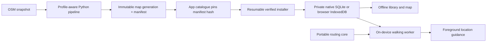

# OFFGRID

**Choose an area. Download its maps. Keep them when the network disappears.**

OFFGRID has an installable Android pilot, a web companion, verified offline maps, on-device walking routes and foreground location guidance. The first phone-test region is **Prayagraj, Uttar Pradesh**. Native storage, reopening, file checking, offline route planning and Back navigation passed on a Samsung Galaxy M53 / Android 15. Live GPS and field acceptance remain open; this is a pilot, not an approved production release. See [Android setup and release gates](docs/ANDROID_RELEASE.md). Safe destinations, signed hazards and BLE mesh remain future work.

## Run the app

Requires Node 22.12+, pnpm 12.3.4 and Python 3.12 for pipeline checks. The starter packs are already included; no OSM download or API key is required to run the app.

```sh
pnpm install --frozen-lockfile
pnpm build
pnpm preview
```

Open **http://127.0.0.1:4173/**. Choose an area, inspect its coverage, download it, then disable the network and reload. **Check offline files** re-verifies the installed pack without a network request. **Downloaded** shows saved areas; removal asks for an explicit confirmation.

For development with hot reload, use `pnpm dev`. The development server does not register the offline service worker; use the production preview to test offline reopening. The Android app is under `apps/web/android`; see the [Android build and phone-test guide](docs/ANDROID_RELEASE.md). The browser companion needs HTTPS hosting for installation away from localhost.

## Included areas

| Map pack | Download rectangle area | Map-file bytes |
| --- | --- | ---: |
| Prayagraj city / Naini / Jhunsi / Phaphamau | 841.80 km² | 9,878,890 |
| Connaught Place, Central Delhi | 2.60 km² | 381,130 |
| Hauz Khas / Green Park, South Delhi | 4.75 km² | 307,376 |
| Sector 18 / Botanical Garden, Noida | 4.25 km² | 220,371 |

Prayagraj is a broad city-area pack; the Delhi/Noida packs are **bounded starter neighborhoods**. None is a whole-district download. Exact outlines, source dates and measured sizes are visible before downloading. The app shell and lightweight previews are separate from these map-file totals. Original OSM snapshot metadata and source checksums are preserved in each manifest and the committed compressed snapshots.

## What works

- Search and select a supported area, or explicitly request a location-based recommendation. Unsupported locations receive nearby feedback and remain a manual choice; there is no automatic location permission prompt or application-server location upload.
- Preview geographic coverage with actual OSM streets and readable labels.
- Pan and pinch coverage/navigation maps with a locally bundled WebGL renderer, zoom-dependent detail and standard map gestures. See [map rendering and measurements](docs/MAP_RENDERING.md).
- Download real map/graph assets with progress, pause, persisted resume, HTTP Range support, checksums and structural verification.
- Stage immutable dataset generations and atomically activate only a complete verified pack. Interrupted updates retain the previous working map.
- Store maps in IndexedDB, request persistence, handle quota/connection failures, recheck files after reopening, repair damaged data and remove active/abandoned area files.
- Reopen the production application offline with locally cached scripts, styles, fonts and icons. A waiting app update requires a user action and pauses no download automatically.
- Plan walking routes from path-interior points, search local places, inspect directions and use foreground guidance with stale/poor-accuracy handling, off-route feedback and manual recalculation.
- Route in the portable core with bidirectional A*, explicit point-to-point/escape coverage states, bounded overlays and independently checked fixture costs.

## Architecture



The four published datasets use a conservative `walking-v1` profile. The original PBF CLI retains its legacy motor profile. Node barrier/access tags are respected when present in the source. Neither profile models all conditional/legal/accessibility rules or certifies an emergency route.

The app release pins the manifest hash; the manifest pins every file. This assumes a trusted initial app origin/release. There are no signing secrets in the browser, no routing backend and no accounts. See [map-pack contracts and recovery behavior](docs/MAP_PACKS.md).

## Routing fixes in this milestone

1. Direct one-way paths are retained when equal priorities would otherwise exhaust one frontier before the opposite search settles a node.
2. Coordinate quantization occurs before travel-cost calculation and tile ownership decisions, matching the serialized Float32 model. Tile ingestion rejects an endpoint bound greater than an edge cost.
3. Nearest-exit search remains Map-compatible while exposing coverage, missing cells, budgets and unknown endpoints; its overlays obey the same integer 1–20× contract.
4. Distinct consecutive nodes at the same coordinate retain a positive-cost connection instead of silently disconnecting the way.

Existing independent reference Dijkstra logic remains unchanged. Fixtures were regenerated because consistent quantization changes some stored costs; expected costs still come from independent Python searches. The 40 new precision graphs exercise 3,545 queries after serialization.

## Checks

```sh
pnpm typecheck
pnpm test
pnpm build
pnpm test:build
pnpm test:packs
python -m pip install -r packages/pipeline/requirements-dev.txt
python -m pytest packages/pipeline/tests
pnpm test:e2e
```

Windows browser tests use installed Chrome by default. CI installs Chromium; on other local systems install it with `pnpm --filter @offgrid/web exec playwright install chromium`. `OFFGRID_BROWSER_CHANNEL` can select another installed Chromium channel.

Current evidence is recorded in [IMPLEMENTATION_NOTES.md](IMPLEMENTATION_NOTES.md). The historical real-Delhi suite still skips four tests without the full generated `data/tiles` dataset. Published-pack checks include Prayagraj and 240 reference route comparisons. They do not replace the absent historical Delhi dataset or physical-device testing.

## Build or refresh packs

`pnpm packs:build` rebuilds the included packs from local or committed compressed source snapshots without a network request. To update source data deliberately, use the fetch tool, then rebuild and verify:

```sh
python packages/pipeline/fetch_starter_regions.py --refresh --region prayagraj-city --save-snapshots
pnpm packs:build
pnpm build
pnpm test:packs
```

See [docs/MAP_PACKS.md](docs/MAP_PACKS.md) for generation identity, manifests, resume behavior, storage and adding coverage. Pack publication is content-addressed and preserves earlier generations.

## Repository

- `apps/web`: React/TypeScript/Vite app, Capacitor Android project, native map storage/location integration, routing worker and browser/device tests.
- `packages/maps`: manifests, storage contract, verified resumable installation and directed edge-interior walking planner.
- `packages/core`: DOM-free graph/routing primitives and independent-oracle tests.
- `packages/pipeline`: graph generation, walking/motor profile policy and immutable pack publishing.

Read [ENGINEERING_LOG.md](ENGINEERING_LOG.md) before changing routing or the tile format. [PRODUCTION_READINESS.md](PRODUCTION_READINESS.md) separates historical checks from remaining release work.

## Licenses

Source code: [MIT](LICENSE). Map data: [OpenStreetMap contributors, ODbL](https://www.openstreetmap.org/copyright), with source snapshots and attribution retained. The code license does not replace map-data obligations. Bundled dependency/font notices are under `apps/web/public/licenses`.
