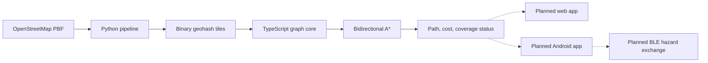

# OffGrid

### Navigation for when the network goes down.

OffGrid is building toward offline emergency navigation: compute routes on-device from downloaded road data, then exchange local hazard reports between nearby phones without a central server.

**Today, this repository contains the routing engine and map-data pipeline.** They run and can be tested locally. The mobile application, offline basemap, and peer-to-peer hazard transport are still planned.

[Get started](#get-started) · [Architecture](#architecture) · [Verification](#verification) · [Roadmap](#roadmap) · [Production readiness](PRODUCTION_READINESS.md)

> **Development status:** routing prototype, not field-ready. The current graph models motor roads and vehicle travel times; it must not be presented as pedestrian evacuation guidance. There is no live app or APK yet.

## Why OffGrid?

When connectivity disappears, navigation should still be able to answer a basic question: **how can I get from here to there using the map already on my phone?**

OffGrid starts with that foundation. OpenStreetMap data becomes compact local graph tiles. A routing engine searches those tiles without a network request. The planned hazard layer will make reports visible and dismissible, so people can understand why a suggested route changes.

The intended deployment has no application backend for routing. Map downloads and updates will still require connectivity before offline use.

## What works today

| Capability | Implementation |
| --- | --- |
| Map-data pipeline | Python converts an OSM PBF extract into binary geohash-6 tiles |
| Local routing | Bidirectional A* over forward and reverse CSR adjacency |
| Routing checks | Reference Dijkstra, independent fixture costs, and adversarial graph tests |
| Multi-target costs | Reverse multi-source Dijkstra finds costs to the nearest supplied exit node |
| Cost overlays | Direction-aware callbacks support integer edge penalties capped at 20× |
| Input validation | Checks tile structure, coordinates, geometry references, adjacency, and format limits |
| Package build | DOM-free TypeScript core emits JavaScript ESM and type declarations |
| Continuous integration | Node 22/24 and Python 3.12 checks, fixture regeneration, and npm dependency audit |

**Still planned:** GPS and road snapping, map UI, verified offline downloads, IndexedDB storage, signed hazard reports, and native BLE exchange. Exit nodes in tests are fixtures; real safe-exit data and safety assessment are not implemented.

## Architecture



The pipeline simplifies road geometry while preserving routing choices, labels connected components, and writes forward and reverse adjacency. Boundary nodes appear as halo entries in neighboring tiles, allowing the core to report which additional cells a query needs.

Tile arrays hold integer edge weights in centiseconds. Node IDs are dense indices assigned during a dataset build, so tiles from different generations must never be mixed. The core validates incoming tile structure, but verified dataset installation is still a release blocker.

## Get started

### Requirements

- **Node.js 22.12+**; CI checks Node 22 and 24.
- **pnpm 12.3.4**, as pinned in `package.json`.
- **Python 3.12** for the tested pipeline setup.

### Build and check the routing core

```sh
git clone https://github.com/Stark2028/offgrid-emergency-nav.git
cd offgrid-emergency-nav
pnpm install --frozen-lockfile
pnpm typecheck
pnpm test
pnpm build
pnpm test:build
```

`pnpm test:build` is a runnable fixture demonstration: plain Node imports `@offgrid/core`, loads the committed grid tiles, and checks route costs against independently generated expectations. It needs no map download, browser, or API key.

Build before importing `@offgrid/core`; its exports point to generated files in `packages/core/dist/`. The package is currently private to this workspace and is not published to npm.

### Run the Python tests

Create a virtual environment from the repository root, then use the commands for your platform.

**Windows / PowerShell**

```powershell
python -m venv packages/pipeline/.venv
./packages/pipeline/.venv/Scripts/python.exe -m pip install -r packages/pipeline/requirements-dev.txt
./packages/pipeline/.venv/Scripts/python.exe -m pytest packages/pipeline/tests
```

**macOS / Linux**

```sh
python3 -m venv packages/pipeline/.venv
./packages/pipeline/.venv/bin/python -m pip install -r packages/pipeline/requirements-dev.txt
./packages/pipeline/.venv/bin/python -m pytest packages/pipeline/tests
```

These tests use committed fixtures and need neither PyOsmium nor a production OSM extract. To build real map data, see the [pipeline setup and source-data guide](packages/pipeline/README.md); install its separate `requirements.txt` and provide an extract to `build_graph.py`.

There is no web development server yet: `apps/web` is not implemented, and the root `dev` script targets that future package.

## Verification

The hardening review on **27 October 2026** recorded:

| Check | Result |
| --- | --- |
| TypeScript fixture and regression tests | **139 passed** |
| Python pipeline tests | **152 passed** |
| Real-Delhi scale tests | **4 skipped** without generated `data/tiles` |
| Type checking, ESM build, and public-package import check | Passed |
| Hosted CI on Node 22/24 and Python 3.12 | Passed for the hardening revision |
| npm dependency audit | No known advisories reported at review time |

See [GitHub Actions](https://github.com/Stark2028/offgrid-emergency-nav/actions) for results on the current revision. Test counts and dependency-audit results are snapshots, not permanent guarantees.

Routing tests compare **costs**, since equal-cost optimal paths can differ. They also check that returned paths follow real edges, respect direction, and sum to the reported cost. Asymmetric penalties exercise backward-search behavior; corrupt-tile and integer-boundary cases guard against plausible-looking failures.

The optional scale harness compares 2,000 sampled origin/destination pairs against reference Dijkstra when real tiles are present. A fresh clone does **not** run that dataset-dependent check. See the [readiness review](PRODUCTION_READINESS.md) for coverage limits and work needed before field testing.

### Historical Delhi measurements

The [engineering log](ENGINEERING_LOG.md#facts-about-the-data-measured-not-estimated) records an earlier generated dataset with **246,466 nodes**, **658,533 edges**, and **3,463 tiles**, totaling **28.5 MB**. Across 420 routable pairs, the corrected A* implementation settled an average of **872 nodes**, versus **2,501** for Dijkstra—about **65% fewer**.

Those measurements predate the latest hardening changes and were not rerun during that review. They measure search effort, not route latency, battery consumption, or phone performance. Production extracts and generated city tiles are excluded from Git; small test fixtures are committed.

## Engineering decisions

- **Integer edge costs.** Centiseconds keep cost comparisons reproducible. Heap priorities use 64-bit floats to preserve exact integer values beyond the 32-bit edge-weight range; unsafe priorities are rejected.
- **Balanced bidirectional potentials.** Forward and backward heuristics sum to zero. Search termination uses a best-path bound rather than stopping at the first shared frontier node.
- **Explicit incomplete results.** A route reports `complete`, `missing-tiles`, or `budget-exceeded`. A finite path from an incomplete search is not proof of optimality; consumers must check the status.
- **Bounded hazard penalties.** The routing overlay accepts costs from the original weight up to 20× it. The planned report system must expose uncertainty and age; signatures alone do not prove that reports are true or witnesses independent.
- **Exact peer reconciliation is planned.** Sorted report IDs avoid Bloom-filter false positives silently suppressing delivery. Messaging is outside the project's scope.
- **Native mesh is a separate milestone.** The intended web target provides offline routing; automatic BLE exchange belongs to a native Android implementation and requires physical-device validation. No anonymity claim is made.

The [engineering log](ENGINEERING_LOG.md) explains these decisions, earlier routing failures, and attempted fixes that should not be repeated.

## Roadmap

1. **Make the data fit the journey.** Implement an explicit pedestrian profile, verified dataset generations, and reproducible real-data validation.
2. **Deliver useful offline navigation.** Build GPS/manual-start flows, road snapping, route geometry, map rendering, and recoverable local storage.
3. **Add advisory hazards.** Implement signed reports, expiry, replay protection, receiver limits, visible provenance, and dismissal.
4. **Validate nearby exchange.** Test native BLE discovery, permissions, reconnection, and screen-off behavior on physical Android devices.
5. **Prove the field experience.** Exercise airplane-mode starts, interrupted downloads, storage eviction, accessibility, updates, and rollback on budget hardware.

The detailed [task list](TASKS.md) tracks implementation work. The [production-readiness review](PRODUCTION_READINESS.md) prioritizes release blockers and states what has not been tested.

## Repository guide

```text
packages/
  core/
    src/                  Geographic primitives, tile readers, graph access, routing
    test/                 Regression tests and committed binary fixtures
    tools/                Built-package smoke test
  pipeline/
    graph.py              Graph construction and simplification
    roads.py              Motor-road classification, access rules, and speeds
    tiles.py              Binary tile serialization
    build_graph.py        OSM-to-tile build entry point
    tests/                Python regression tests
    tools/                Cross-language fixture generators
.github/workflows/ci.yml   Automated core and pipeline checks
```

## Contributing

Read [ENGINEERING_LOG.md](ENGINEERING_LOG.md) before changing routing, tile encoding, or mesh design. Keep the reference Dijkstra independent, compare route costs rather than exact tied paths, and run the relevant suites before claiming a fix. Coordinate tile-format changes across Python, TypeScript, and generated fixtures.

Bug reports are most useful with a reproducible graph or fixture, source/target IDs, loaded tile cells, expected behavior, and actual route status. Keep performance claims tied to a recorded dataset and an executed benchmark.

## License and map data

Package metadata declares the code **MIT**. OpenStreetMap data has separate attribution and licensing requirements; see [OpenStreetMap copyright and license](https://www.openstreetmap.org/copyright) before distributing datasets or a map application.
